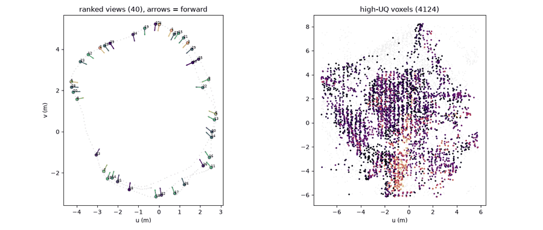
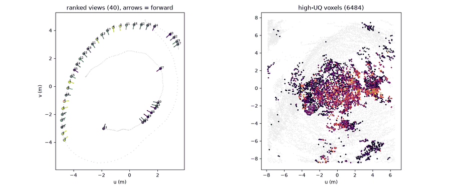
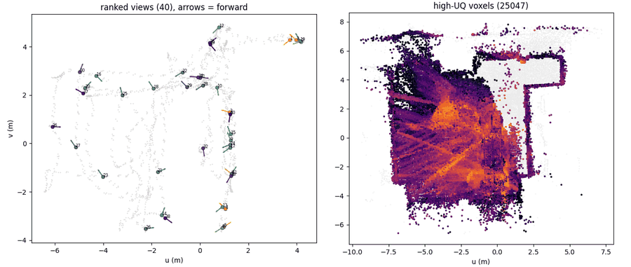
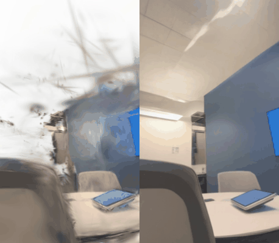
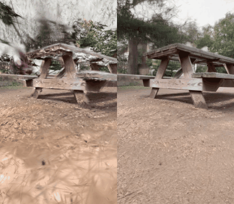
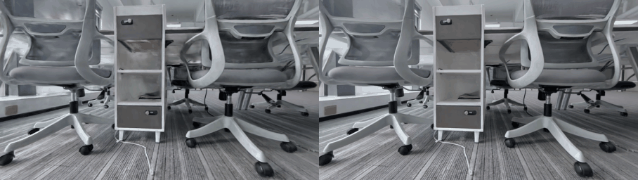
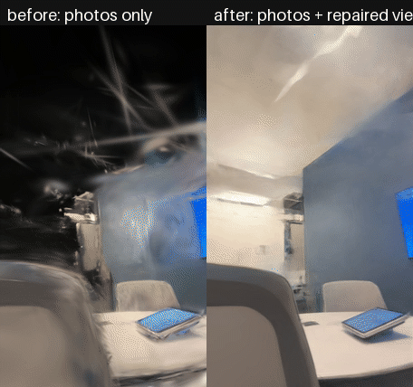
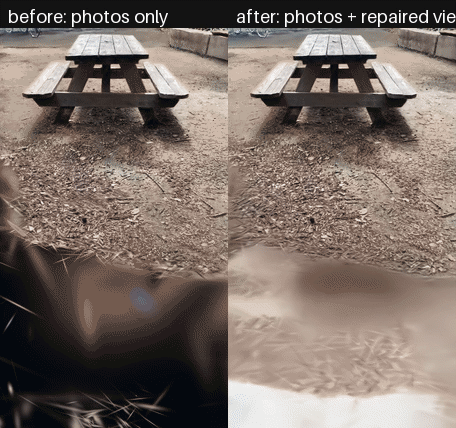
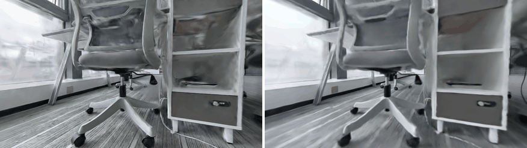
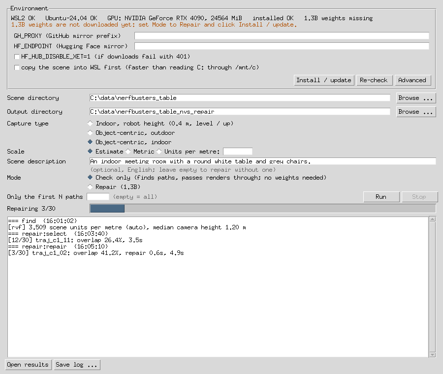

<p align="center">
  <a href="https://www.scanark.net/"></a>
</p>
<p align="center">
  <b>Redefining simulation with a physical-world generation engine.</b>
</p>
<p align="center">
  <a href="README.md">简体中文</a> | English
</p>

# nvs_repair

**Fully automatic defect localisation and novel-view repair for 3D Gaussian Splatting scenes.**

A 3DGS model renders well near its training views but degrades away from them,
with holes, floaters and smearing. Given a trained scene, nvs_repair
**fully automatically localises the defective regions**, generates and ranks
**the camera trajectories that render worst**, and repairs those trajectories
with a video repair model **guided by the real photos**. The output is a set of
**repaired frames with their camera poses**, **ready to be used in 3DGS
training**. Typical applications:

- **Training data for robot viewpoints**: realistic, posed images from the
  **low, close-range viewpoints of a robot**, generated from a conventional
  handheld or multi-camera capture;
- **Improved 3DGS reconstruction**: **views missing from the capture** are added
  and the scene is retrained, improving quality **from every direction**.

```
 trained 3DGS + COLMAP + photos
   │
   ├─ 1. defect localisation   uncertainty-based localisation of defective regions
   │     and trajectory search  and automatic generation of repair trajectories
   ├─ 2. reference selection    real photos chosen by view coverage
   └─ 3. repair                 a video repair model (replaceable)
   │
   ▼
 repaired frames + camera poses  ──►  any 3DGS trainer (not included)
```

## Features

- **Fully automatic defect localisation.** Using
  [GAVIS](https://github.com/xsj01/gavis)'s visibility-aware uncertainty,
  nvs_repair computes the scene's uncertainty in 3D and locates the regions
  where rendering defects concentrate, **without manual annotation or view
  selection**.
- **Fully automatic repair-trajectory search.** **Candidate camera trajectories
  are generated automatically** around the defective regions and ranked by
  uncertainty, scene coverage and spacing; **the most valuable ones** are kept
  for repair. Floor, up direction and scene scale are **estimated
  automatically** from the capture, and presets are provided for indoor
  robot-height views and object-centric captures.
- **Reference selection by view coverage.** At inference, each trajectory is
  conditioned on a set of real photos, **selected one by one by view coverage**
  so that together they observe what the trajectory sees from similar
  directions.
- **Replaceable video repair model.** [ArtiFixer](https://github.com/nv-tlabs/ArtiFixer)
  1.3B / 14B is the default; **custom repair models** can be plugged in through
  an interface.
- **Progressive repair.** Trajectories are repaired in sequence; later
  trajectories can use frames already repaired as references.
- **16 GB GPU support.** A low-memory mode runs ArtiFixer 1.3B on a **16 GB GPU**
  with identical output and is enabled automatically when needed; the 14B model
  is supported on Linux.
- **Independent of the 3DGS trainer.** The output consists of **standard images
  and camera poses** (nerfstudio `transforms.json`), usable with **any 3DGS
  trainer**.
- **Multi-platform.** A Linux command-line tool and a Windows application
  (offline bundle or WSL 2).

## Results

The examples cover *table* (indoor, captured around a table, 286 photos) and
*picnic* (outdoor, portrait phone video, 320 photos) from the
[Nerfbusters](https://ethanweber.me/nerfbusters) dataset, and *office*, an
office captured with a multi-camera rig (**self-collected data**).

> *office* comes from [ScanArk](https://www.scanark.net/)'s own capture and
> reconstruction pipeline. ScanArk's industry-leading scanning technology and
> high-precision 3DGS reconstruction provide high-quality data for spatial
> intelligence and Physical AI.

### 1. Defect localisation and trajectory search

| *table* | *picnic* | *office* (self-collected) |
|---|---|---|
|  |  |  |

Top-down views. Left: the 40 most uncertain candidate views along the capture
path (grey), with arrows indicating viewing direction. Right: the automatically
localised high-uncertainty voxels; brighter means more uncertain. Repair
trajectories are generated around these regions and views.

### 2. Repairing the trajectories (ArtiFixer 14B)

| *table* | *picnic* | *office* (self-collected) |
|---|---|---|
|  |  |  |

Left: the 3DGS render along an automatically found trajectory. Right: the repaired result.

### 3. 3DGS trained with the repaired frames

nvs_repair **does not include a 3DGS trainer**; the repaired frames can be used
with any trainer (INRIA 3DGS, gsplat, nerfstudio splatfacto, etc.).

| *table* | *picnic* | *office* (self-collected) |
|---|---|---|
|  |  |  |

Left: trained on the photos only. Right: trained with the repaired frames
added. *table* and *picnic* use INRIA 3DGS for 30k steps, with every 4th
repaired frame added at the same weight as the photos; *office* uses ScanArk's
in-house trainer, continuing from the photos-only model with the repaired
frames added.

## Deployment

All versions require an NVIDIA GPU with 16 GB of memory to run ArtiFixer 1.3B
(the 14B model requires about 89 GB and is supported on Linux only). About 33 GB
of weights are downloaded on first use.

| | Linux | Windows, offline bundle | Windows, WSL |
|---|---|---|---|
| Intended for | servers, batch processing, the 14B model | most Windows PCs; only the GPU driver is required | PCs with WSL 2 enabled |
| Guide | [docs/linux.md](docs/linux.md) | [docs/windows-offline.md](docs/windows-offline.md) | [docs/windows-wsl.md](docs/windows-wsl.md) |

**Linux.** Requires CUDA 12.8, Python 3.12 and git.

```bash
git clone https://github.com/ScanArk-AI/NVS_Auto_Repair.git && cd NVS_Auto_Repair
./bootstrap.sh --variant 1.3b                                      # environment, extensions, weights
PY=~/nvs_repair_runtime/envs/nvs/bin/python
$PY run.py make-config --scene-root /data/my_scene --object-centric-indoor
$PY run.py all --config configs/scenes/generated/my_scene/workflow.yaml \
    --set "workflow.caption_text=A small meeting room with a round white table."
```

**Windows, offline bundle.** Download the `nvs_repair-<version>-win64.7z.*`
volumes from [Releases](https://github.com/ScanArk-AI/NVS_Auto_Repair/releases),
extract the `.001` volume with 7-Zip and run `nvs_repair.exe`. **Install /
update** downloads the remaining components; then select the scene folder and
click **Run**.

**Windows, WSL.** Run `wsl --install -d Ubuntu-24.04` once and create a Linux
user. Download `nvs_repair-<version>-windows.zip` from
[Releases](https://github.com/ScanArk-AI/NVS_Auto_Repair/releases), extract it and
run `nvs_repair.exe`; **Install / update** completes the installation inside WSL.



### Configuration

The input is a scene folder containing a trained 3DGS `.ply`, the COLMAP model it
was trained from, and the photos. `make-config` (or the Windows application)
generates the configuration files; any option can be overridden per run with
`--set key=value`. Main options:

| Option | Default | Description |
|---|---|---|
| capture type: `make-config --object-centric` / `--object-centric-indoor` | indoor, robot height | trajectory type: low indoor views, or views around a subject outdoors / indoors |
| `find.set: geometry.units_per_metre=…` | `auto` | scene units per metre; `1` for metric captures, `auto` for automatic estimation from the camera height |
| `find.set: trajectories.height_m=…` | `0.4` | trajectory height above the floor, in metres; a list is tried value by value |
| `find.set: geometry.up=… / geometry.floor_m=…` | estimated | up direction and floor height, if set manually |
| `model.variant` | `1.3b` | `1.3b` (16 GB) or `14b` (~89 GB) |
| `workflow.caption_text` | – | scene description used as the text condition for the repair; generated by a vision-language model if not set (`NVS_REPAIR_VLM_*`) |
| `workflow.reference_mode` | `photos` | `progressive`: later trajectories may use already repaired frames as references |
| `repair.set: refer.num_views=…` | `12` | number of reference photos per trajectory |
| `repair.set: refer.strategy=…` | `coverage` | `coverage` (by view direction) or `overlap` (most shared Gaussians) |
| `repair.set: refer.max_mask_frac=…` | `0.10` | photos whose dynamic-object mask exceeds this fraction are not selected |
| `repair.set: model.low_vram=…` | automatic | force the 16 GB mode on or off |
| `repair.set: model.backend=…` | `artifixer` | `passthrough` for a pipeline check without weights; `package.module:Class` for a custom model |
| `workflow.vram_wait_min` | `30` | maximum time to wait for a busy GPU, in minutes |

Input requirements, scene scale, trajectory presets, reference selection, scene
descriptions and other scene layouts (e.g. nerfstudio data) are described in
[docs/configuration.md](docs/configuration.md).

## Acknowledgements

nvs_repair builds on the following work:

- [GAVIS](https://github.com/xsj01/gavis) -- visibility-aware uncertainty for
  3DGS, the basis of defect localisation and trajectory search.
- [ArtiFixer](https://github.com/nv-tlabs/ArtiFixer) (NVIDIA) -- the video
  repair model, and the [Wan2.1](https://huggingface.co/Wan-AI) models it builds on.
- [3D Gaussian Splatting](https://github.com/graphdeco-inria/gaussian-splatting)
  (INRIA / MPII) -- the differentiable rasteriser and simple-knn, and
  [gavis_rasterizer](https://github.com/xsj01/gavis_rasterizer).
- [gsplat](https://github.com/nerfstudio-project/gsplat) and
  [nerfacc](https://github.com/nerfstudio-project/nerfacc) from nerfstudio.
- The [Nerfbusters](https://ethanweber.me/nerfbusters) dataset (Warburg, Weber
  et al., ICCV 2023) for the *table* and *picnic* scenes.

If you use nvs_repair in research, please cite GAVIS and ArtiFixer.

nvs_repair is released under [Apache-2.0](LICENSE); see [NOTICE.md](NOTICE.md).
