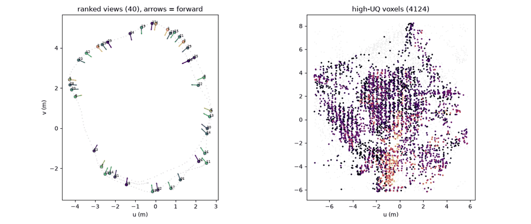
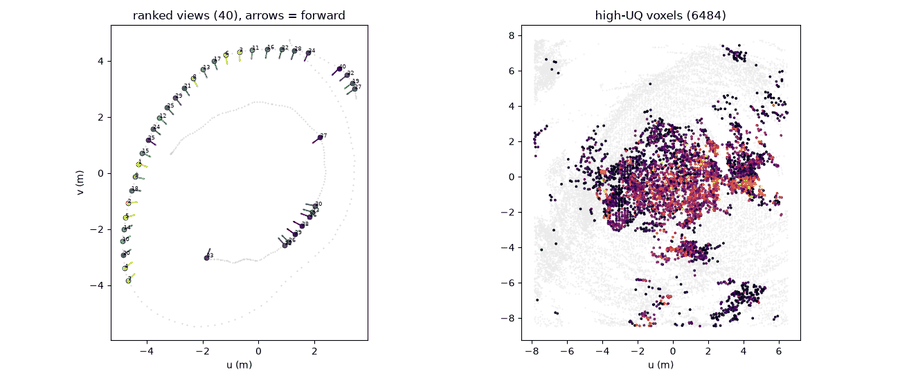
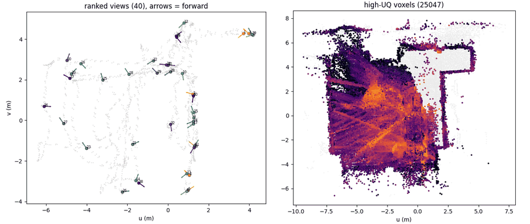
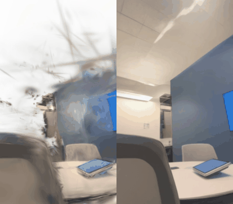
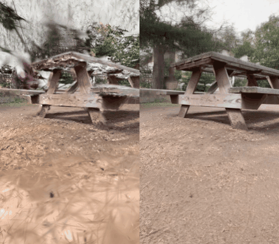
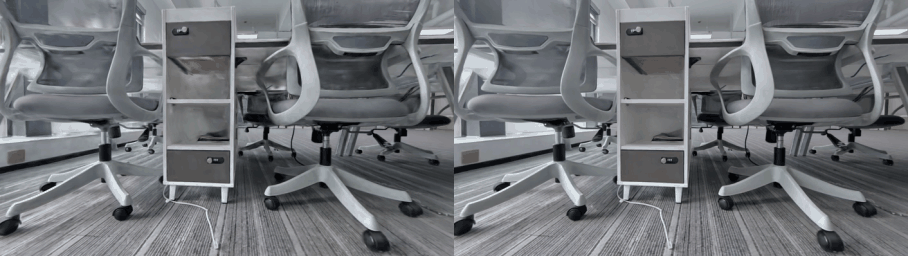
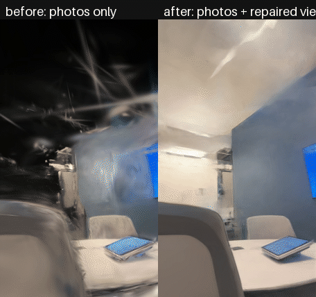
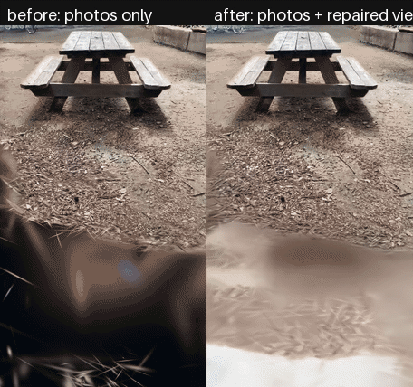
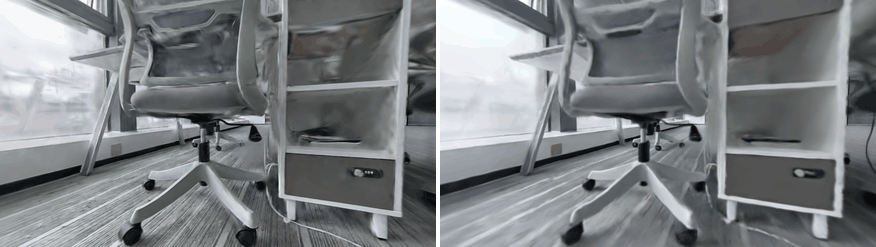
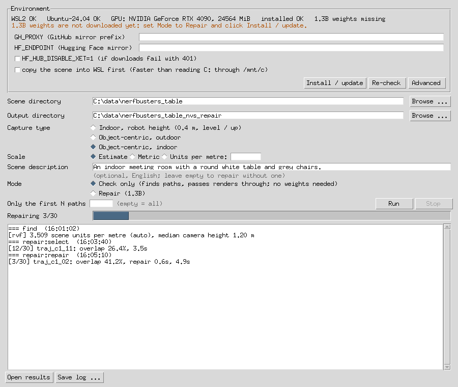

<p align="center">
  <a href="https://www.scanark.net/"></a>
</p>
<p align="center">
  <b>以物理世界生成引擎，重新定义仿真</b>
</p>
<p align="center">
  简体中文 | <a href="README.en.md">English</a>
</p>

# nvs_repair

**面向 3D Gaussian Splatting 场景的全自动缺陷定位与新视角修复工具。**

3DGS 模型在训练视角附近具有很高的渲染质量，但在远离训练视角的位置往往出现空洞、漂浮物与拖影。nvs_repair 以训练完成的场景为输入，**全自动**地**定位场景中的缺陷区域**，生成并筛选出**渲染质量最差的相机轨迹**；随后**以真实照片为参考**，使用视频修复模型修复这些轨迹上的画面，最终输出**修复帧及对应的相机位姿**，可**直接用于 3DGS 训练**。主要用途：

- **机器人视角训练数据优化**：基于常规的手持或多相机采集数据，生成**机器人视角（低位、近距离）**下具有真实感的图像，并附带相机位姿；
- **3DGS 重建质量增强**：补充采集过程中**未覆盖的视角**并重新训练，提升场景在**各个方向**上的重建质量。

```
 训练完成的 3DGS + COLMAP + 照片
   │
   ├─ 1. 缺陷定位与轨迹寻找   基于渲染不确定度，自动定位缺陷区域并生成修复轨迹
   ├─ 2. 参考帧选取           按视角覆盖为每条轨迹选取真实照片
   └─ 3. 轨迹修复             视频修复模型（可替换）
   │
   ▼
 修复帧 + 相机位姿  ──►  任意 3DGS 训练器（不包含在本项目中）
```

## 功能

- **全自动缺陷区域定位。** 基于 [GAVIS](https://github.com/xsj01/gavis) 的可见性感知不确定度，在三维空间中计算场景的不确定度分布，自动定位渲染缺陷集中的区域，**无需人工标注或挑选视角**。
- **全自动修复轨迹寻找。** 围绕缺陷区域**自动生成候选相机轨迹**，综合不确定度、场景覆盖与轨迹间距进行排序与筛选，输出**最值得修复的轨迹**。地面、上方向与场景尺度均由采集数据**自动估计**；内置室内低视角（机器人高度）与环绕拍摄（物体中心）两类预设。
- **基于视角覆盖的参考帧选取。** 推理时，每条轨迹以一组真实照片作为参考。照片**按视角覆盖逐张选取**，使其整体能够从相近方向观察到轨迹所见的内容。
- **可替换的视频修复模型。** 默认使用 [ArtiFixer](https://github.com/nv-tlabs/ArtiFixer) 1.3B / 14B，也可通过接口**接入自定义的修复模型**。
- **渐进式修复。** 按顺序逐条修复轨迹，后续轨迹可使用已修复的帧作为参考。
- **支持 16 GB 显卡。** 低显存模式可在 **16 GB 显卡**上运行 ArtiFixer 1.3B，输出结果完全一致，并按需自动启用；Linux 版本支持 14B 模型。
- **与 3DGS 训练器解耦。** 输出为**标准图像及相机位姿**（nerfstudio `transforms.json` 格式），可用于**任意 3DGS 训练器**。
- **多平台。** 提供 Linux 命令行工具，以及 Windows 图形界面（离线包与 WSL 2 两种形式）。

## 效果展示

展示数据包括 [Nerfbusters](https://ethanweber.me/nerfbusters) 数据集中的 *table*（室内，环绕桌子拍摄，286 张照片）与 *picnic*（户外，手机竖屏视频，320 张照片），以及使用多相机设备采集的办公室场景 *office*（**自采数据**）。

> *office* 来自 [ScanArk](https://www.scanark.net/) 自有的采集与重建流程。ScanArk 拥有行业领先的扫描技术与高精度 3DGS 重建算法，为空间智能与物理 AI 场景提供高质量数据。

### 1. 缺陷定位与轨迹寻找

| *table* | *picnic* | *office*（自采数据） |
|---|---|---|
|  |  |  |

俯视图。左：采集路径（灰色）上不确定度最高的 40 个候选视角，箭头表示朝向；右：自动定位的高不确定度体素，亮度越高表示不确定度越高。修复轨迹围绕这些区域与视角生成。

### 2. 轨迹修复（ArtiFixer 14B）

| *table* | *picnic* | *office*（自采数据） |
|---|---|---|
|  |  |  |

左：沿自动寻找的轨迹渲染的 3DGS 画面；右：修复结果。

### 3. 加入修复帧后的 3DGS

本项目**不包含 3DGS 训练器**，修复帧可用于任意训练器（INRIA 3DGS、gsplat、nerfstudio splatfacto 等）。

| *table* | *picnic* | *office*（自采数据） |
|---|---|---|
|  |  |  |

左：仅使用照片训练；右：加入修复帧后训练。*table* 与 *picnic* 使用 INRIA 3DGS 训练 30k 步，修复帧每 4 帧取 1 帧，与照片权重相同；*office* 使用 ScanArk 内部训练器，在仅用照片训练的模型基础上加入修复帧继续训练。

## 部署

各版本均需配备 16 GB 显存的 NVIDIA 显卡以运行 ArtiFixer 1.3B（14B 模型需约 89 GB 显存，仅支持 Linux），首次使用时需下载约 33 GB 权重。

| | Linux | Windows 离线包 | Windows WSL 版 |
|---|---|---|---|
| 适用场景 | 服务器、批量处理、14B 模型 | 大多数 Windows 电脑，仅需安装显卡驱动 | 已启用 WSL 2 的电脑 |
| 详细说明 | [docs/linux.zh-CN.md](docs/linux.zh-CN.md) | [docs/windows-offline.zh-CN.md](docs/windows-offline.zh-CN.md) | [docs/windows-wsl.zh-CN.md](docs/windows-wsl.zh-CN.md) |

**Linux。** 需要 CUDA 12.8、Python 3.12 与 git。

```bash
git clone https://github.com/ScanArk-AI/NVS_Auto_Repair.git && cd NVS_Auto_Repair
./bootstrap.sh --variant 1.3b                                      # 环境、CUDA 扩展、权重
PY=~/nvs_repair_runtime/envs/nvs/bin/python
$PY run.py make-config --scene-root /data/my_scene --object-centric-indoor
$PY run.py all --config configs/scenes/generated/my_scene/workflow.yaml \
    --set "workflow.caption_text=A small meeting room with a round white table."
```

**Windows 离线包。** 从 [Releases](https://github.com/ScanArk-AI/NVS_Auto_Repair/releases) 下载 `nvs_repair-<版本>-win64.7z.*` 分卷，使用 7-Zip 解压 `.001` 后运行 `nvs_repair.exe`。点击 **Install / update** 下载其余组件，选择场景目录后点击 **Run**。

**Windows WSL 版。** 运行一次 `wsl --install -d Ubuntu-24.04` 并创建 Linux 用户；从 [Releases](https://github.com/ScanArk-AI/NVS_Auto_Repair/releases) 下载 `nvs_repair-<版本>-windows.zip`，解压后运行 `nvs_repair.exe`，点击 **Install / update** 即可在 WSL 中完成安装。



### 配置说明

输入为一个场景目录，包含训练完成的 3DGS `.ply`、训练所用的 COLMAP 模型以及照片。`make-config`（或 Windows 界面）会自动生成配置文件，每次运行均可通过 `--set key=value` 覆盖任意配置项。主要配置项如下：

| 配置项 | 默认值 | 说明 |
|---|---|---|
| 采集类型：`make-config --object-centric` / `--object-centric-indoor` | 室内、机器人高度 | 轨迹类型：室内低视角，或户外 / 室内环绕主体的视角 |
| `find.set: geometry.units_per_metre=…` | `auto` | 每米对应的场景单位；米制采集填 `1`，`auto` 根据相机高度自动估计 |
| `find.set: trajectories.height_m=…` | `0.4` | 轨迹离地高度（米）；填写列表时逐个尝试 |
| `find.set: geometry.up=… / geometry.floor_m=…` | 自动估计 | 上方向与地面高度，可手动指定 |
| `model.variant` | `1.3b` | `1.3b`（16 GB）或 `14b`（约 89 GB） |
| `workflow.caption_text` | – | 场景描述，作为修复的文本条件；未填写时由视觉语言模型自动生成（`NVS_REPAIR_VLM_*`） |
| `workflow.reference_mode` | `photos` | 设为 `progressive` 时，后续轨迹可使用已修复的帧作为参考 |
| `repair.set: refer.num_views=…` | `12` | 每条轨迹的参考照片数量 |
| `repair.set: refer.strategy=…` | `coverage` | `coverage`（按观察方向覆盖）或 `overlap`（共享高斯数量最多） |
| `repair.set: refer.max_mask_frac=…` | `0.10` | 动态物体 mask 占比超过该值的照片不参与选取 |
| `repair.set: model.low_vram=…` | 自动 | 强制开启或关闭 16 GB 模式 |
| `repair.set: model.backend=…` | `artifixer` | `passthrough` 用于不加载权重的流程检查；`package.module:Class` 用于接入自定义模型 |
| `workflow.vram_wait_min` | `30` | 显卡被占用时的最长等待时间（分钟） |

输入要求、场景尺度、轨迹预设、参考帧选取、场景描述及其他目录结构（如 nerfstudio 数据）的说明见 [docs/configuration.zh-CN.md](docs/configuration.zh-CN.md)。

## 致谢

本项目基于以下工作：

- [GAVIS](https://github.com/xsj01/gavis)：3DGS 的可见性感知不确定度，为缺陷定位与轨迹寻找提供基础。
- [ArtiFixer](https://github.com/nv-tlabs/ArtiFixer)（NVIDIA）：视频修复模型；以及其所基于的 [Wan2.1](https://huggingface.co/Wan-AI) 模型。
- [3D Gaussian Splatting](https://github.com/graphdeco-inria/gaussian-splatting)（INRIA / MPII）：可微光栅化器与 simple-knn；以及 [gavis_rasterizer](https://github.com/xsj01/gavis_rasterizer)。
- nerfstudio 的 [gsplat](https://github.com/nerfstudio-project/gsplat) 与 [nerfacc](https://github.com/nerfstudio-project/nerfacc)。
- [Nerfbusters](https://ethanweber.me/nerfbusters) 数据集（Warburg、Weber 等，ICCV 2023），提供 *table* 与 *picnic* 场景。

如在研究中使用 nvs_repair，请引用 GAVIS 与 ArtiFixer。

nvs_repair 采用 [Apache-2.0](LICENSE) 许可证，详见 [NOTICE.md](NOTICE.md)。
