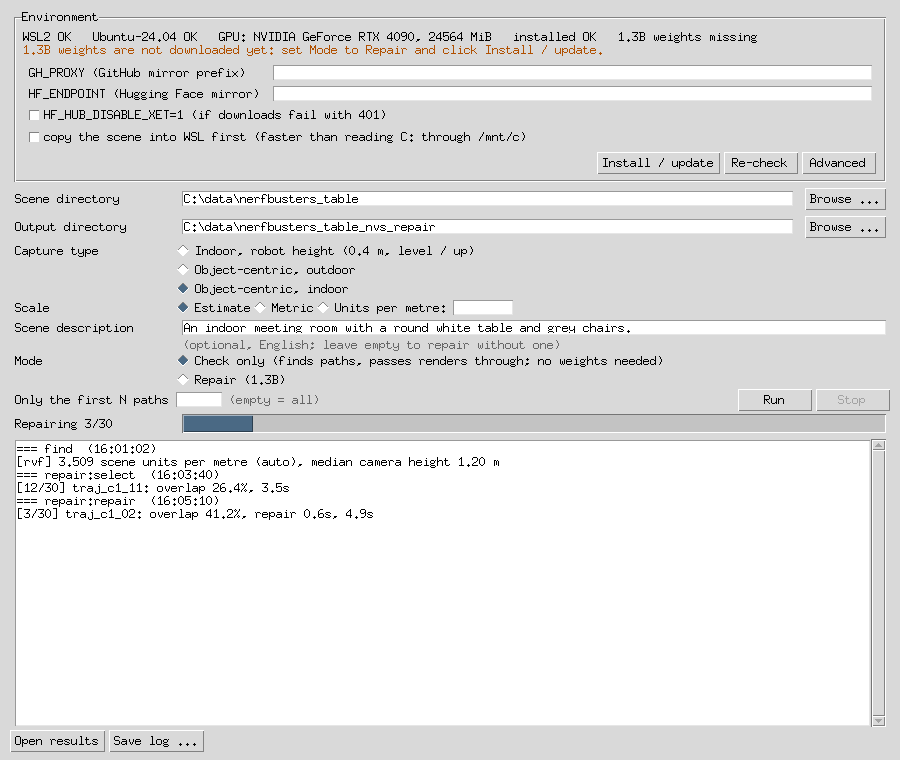

# Windows: WSL version

[中文](windows-wsl.zh-CN.md)

## Install and run

A small Windows app runs the same pipeline inside WSL 2 on your own PC, so the
CUDA extensions, GAVIS and ArtiFixer are fetched and built exactly as on Linux.

**Needs**: Windows 10 22H2 or 11, an NVIDIA GPU with a driver that supports
CUDA in WSL, 16 GB of GPU memory for actual repairs (ArtiFixer 1.3B), and
about 60 GB of free disk.

1. Download `nvs_repair-<version>-windows.zip` from the [Releases page](https://github.com/ScanArk-AI/NVS_Auto_Repair/releases)
   and unzip it. Keep `nvs_repair.exe` next to its `source` folder.
2. Once per PC, in PowerShell **as administrator**:
   `wsl --install -d Ubuntu-24.04`, restart, then open *Ubuntu 24.04* from the
   Start menu once and create a user name and password.
3. Start `nvs_repair.exe`. The top row checks WSL, the distro and the GPU and
   says what is missing. With **Mode: Check only** selected, **Install /
   update** sets up everything except the weights inside WSL -- system packages,
   the CUDA 12.8 toolkit, the Python environment, three CUDA extensions and
   ArtiFixer's code. Select **Repair (1.3B)** and press it again to download the
   1.3B weights (~33 GB). The first install takes roughly 30-60 minutes; pressing
   the button again only redoes what changed.
4. Pick the scene folder (a trained 3DGS `.ply`, its COLMAP model and the
   photos), the output folder and the kind of capture (see [Choosing the path
   settings](configuration.md#choosing-the-path-settings)). With **Check only** selected, press **Run**: it finds the paths
   and passes the renders through, no weights needed. When that looks right,
   select **Repair (1.3B)** and **Run** again (if the weights are not there yet,
   the app asks you to press Install / update first).
5. **Open results** opens the output folder; each path's repaired frames and
   before/after videos are in its `2_repair/`.

Notes: for large scenes, tick "copy the scene into WSL first" under *Advanced*
for faster reads. Mirrors for GitHub / Hugging Face (`GH_PROXY`, `HF_ENDPOINT`) can
be set there too. Everything lives in the Ubuntu-24.04 distro; removing it
(`wsl --unregister Ubuntu-24.04`) deletes the environment, the weights and
anything else in that distro.
