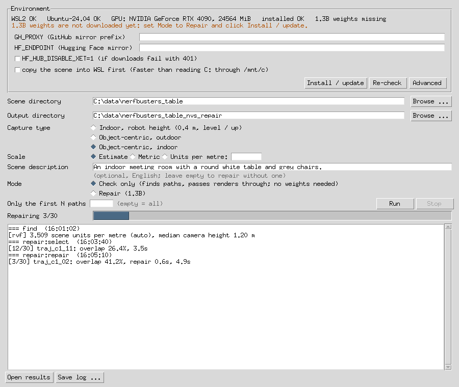

# Windows：WSL 版

[English](windows-wsl.md)

## 安装和运行

WSL 版是一个小程序，在你自己电脑的 WSL 2 里运行同一套流程，所以 CUDA 扩展、GAVIS 和 ArtiFixer 的获取和编译方式都和 Linux 上完全一样。

**要求**：Windows 10 22H2 或 Windows 11；NVIDIA 显卡，驱动要支持在 WSL 里使用 CUDA；正式修复需要 16 GB 显存（ArtiFixer 1.3B）；约 60 GB 可用磁盘。

1. 从 [Releases 页面](https://github.com/ScanArk-AI/NVS_Auto_Repair/releases)下载 `nvs_repair-<版本>-windows.zip` 并解压。`nvs_repair.exe` 要和 `source` 文件夹放在一起。
2. 每台电脑只需做一次：用**管理员身份**打开 PowerShell，运行 `wsl --install -d Ubuntu-24.04`，重启；再从开始菜单打开一次 *Ubuntu 24.04*，设置用户名和密码。
3. 运行 `nvs_repair.exe`。最上面一行会检查 WSL、Ubuntu 和显卡，并提示缺什么。在 **Mode** 选 **Check only** 时点 **Install / update**，会在 WSL 里装好除权重以外的一切：系统包、CUDA 12.8 工具链、Python 环境、三个 CUDA 扩展和 ArtiFixer 的代码。改选 **Repair (1.3B)** 后再点一次，才会下载 1.3B 权重（约 33 GB）。第一次安装大约 30–60 分钟；之后再点只会重做有变化的部分。
4. 选择场景目录（训练好的 3DGS `.ply`、它的 COLMAP 模型和照片）、输出目录，以及采集类型（见[选哪套视角参数](configuration.zh-CN.md#选哪套视角参数)）。先选 **Check only** 点 **Run**：找路径，渲染帧原样返回，不需要权重。确认没问题后改选 **Repair (1.3B)**，再点 **Run**（如果权重还没下载，界面会提示先点 Install / update）。
5. 点 **Open results** 打开输出目录，每条路径修复后的帧和修复前后的对比视频在其中的 `2_repair/` 里。

注意：大场景可以在 *Advanced* 里勾选"先把场景复制到 WSL 里"，读取更快。GitHub 和 Hugging Face 的镜像（`GH_PROXY`、`HF_ENDPOINT`）也在那里设置。所有东西都装在 Ubuntu-24.04 这个发行版里；删除它（`wsl --unregister Ubuntu-24.04`）会把环境、权重以及这个发行版里的其它所有内容一起删掉。
